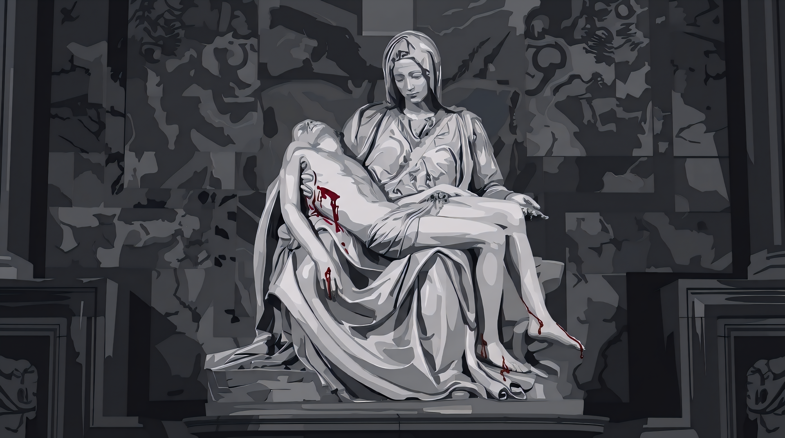

# Pieta — Omarchy Theme

A dark, sculptural chiaroscuro theme for [Omarchy](https://omarchy.org/) inspired by Michelangelo's *Pietà*.

Polished Carrara marble and obsidian shadows punctuated by a single, poignant crimson accent drawn from the sacred wounds.



## Features

- **Chiaroscuro Marble Palette**: Deep obsidian and charcoal marble backgrounds paired with high-contrast alabaster text (11.13:1 contrast ratio).
- **Sacred Wound Crimson Accent**: Interactive elements, borders, and notifications feature a focused ruby-crimson glow (`#c82d40`).
- **Harmonious Stone ANSI Palette**: Terminal and syntax highlighting tuned with cool slates, serpentine greens, antique parchment yellows, and bruised wine tones.
- **4K Artwork Background**: Includes the stylized *Pietà* wallpaper.

## Palette Reference

| Token | Hex | Description |
|---|---|---|
| `accent` | `#c82d40` | Sacred crimson wound |
| `background` | `#18191f` | Charcoal marble |
| `dark_background` | `#121317` | Shadowed alcove |
| `darker_background` | `#0c0d10` | Deepest stone shadow |
| `lighter_background` | `#23252c` | Elevated marble surface |
| `selection` | `#38252e` | Dark wine / slate selection |
| `muted` | `#5d6069` | Slate stone comments |
| `foreground` | `#cfcdd3` | Polished Carrara marble |
| `light_foreground` | `#e0ded4` | Antique alabaster |
| `bright_foreground` | `#edebee` | Pure marble highlight |

## Installation

Install and apply the theme directly in Omarchy:

```bash
omarchy theme install https://github.com/sam-f-gh/omarchy-pieta-theme.git
```

Or apply it if already installed:

```bash
omarchy theme set "Pieta"
```
